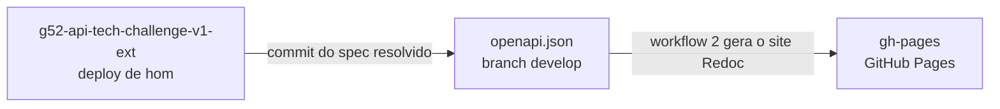

# doc-api-g52-tech-challenge-v1

Documentação pública da API do Tech Challenge (Grupo 52), publicada no GitHub Pages com Redoc:

https://teplotax.github.io/doc-api-g52-tech-challenge-v1/

Este repositório não é editado à mão. O único conteúdo que muda é o `openapi.json`, gerado a partir do contrato da API no repositório [`g52-api-tech-challenge-v1-ext`](https://github.com/Teplotax/g52-api-tech-challenge-v1-ext).

## Como a página é atualizada



1. No merge do PR de `develop` para `release/*` do contrato, o pipeline faz o deploy do stage hom no API Gateway.
2. Em seguida, ele resolve o OpenAPI com o Redocly, remove as rotas internas do MailPit e faz commit do resultado como `openapi.json` na branch `develop` deste repositório.
3. O push em `develop` dispara o workflow `2 - [DEV] Build and Deploy`, que monta a página (`index.html`, `openapi.json` e favicons) e publica na branch `gh-pages`.

A documentação mostra o contrato que está em homologação, com as mesmas rotas, schemas e exemplos importados no API Gateway.

## Estrutura

| Arquivo | Conteúdo |
|---|---|
| `openapi.json` | Spec OpenAPI 3.0 resolvido, atualizado pelo pipeline do contrato |
| `.github/workflows/2-dev-to-release.yml` | Gera o `index.html` com o Redoc e publica no GitHub Pages |
| `favicon.ico`, `*.png`, `site.webmanifest` | Ícones da página |

O Redoc é carregado do CDN com a versão fixa `v2.5.0`. A tag `latest` passou a apontar para um build em módulo ES, que não funciona com a tag `<script>` comum e deixa a página em branco.

## Visualização local

Para ver a documentação sem publicar, a partir da raiz do repositório:

```bash
npx @redocly/cli build-docs openapi.json -o index.html
```

Depois é só abrir o `index.html` no navegador. O arquivo gerado não deve ser commitado, porque a página publicada é montada pelo workflow.

## Workflows

O fluxo de branches é o mesmo dos outros repositórios do grupo: `feature/**`, `develop`, `release/*` e `main`.

| Workflow | Gatilho | Ação |
|---|---|---|
| `1 - [FEAT] Build & PR` | Push em `feature/**` | Abre PR para `develop` |
| `2 - [DEV] Build and Deploy` | Push em `develop` | Publica a página no GitHub Pages e abre o PR para `release/vX.X.X` |
| `3 - [HOM] Promote & Deploy` | Merge do PR em `release/**` | Abre o PR da release para `main` |

A branch `main` é protegida e só recebe merge por Pull Request.

## Repositórios do projeto

| Repositório | Conteúdo |
|---|---|
| [g52-app-tech-challenge](https://github.com/Teplotax/g52-app-tech-challenge) | Aplicação Spring Boot, manifestos Kubernetes e documentação de arquitetura |
| [g52-lambda-tech-challenge](https://github.com/Teplotax/g52-lambda-tech-challenge) | Function Serverless de autenticação (CPF e `client_credentials`) e Lambda Authorizer |
| [g52-infra-eks-tech-challenge](https://github.com/Teplotax/g52-infra-eks-tech-challenge) | Cluster EKS, ECR, add-ons e observabilidade com New Relic |
| [g52-infra-rds-tech-challenge](https://github.com/Teplotax/g52-infra-rds-tech-challenge) | Banco gerenciado (RDS PostgreSQL) e modelo de dados |
| [g52-infra-gateway-tech-challenge](https://github.com/Teplotax/g52-infra-gateway-tech-challenge) | REST API do API Gateway e roles da conta |
| [g52-api-tech-challenge-v1-ext](https://github.com/Teplotax/g52-api-tech-challenge-v1-ext) | Contrato OpenAPI importado no API Gateway, com um stage por ambiente |
| **doc-api-g52-tech-challenge-v1** (este) | Swagger publicado no GitHub Pages |
